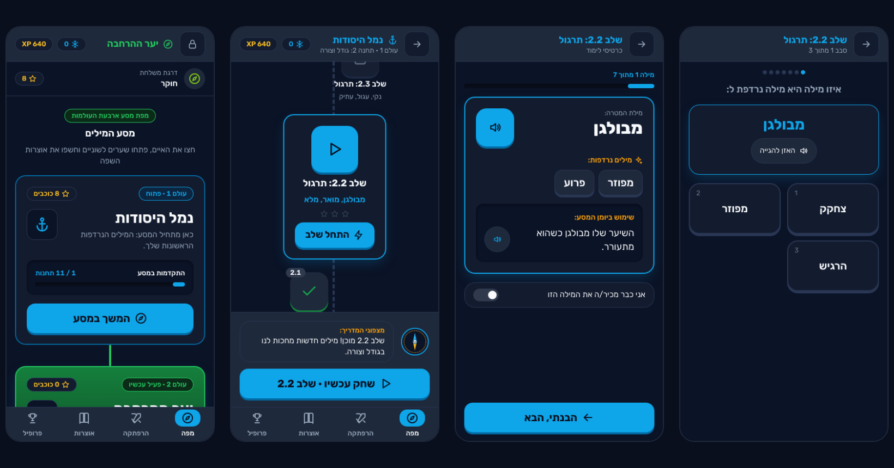

# מסע המילים (Word Quest)

**A Hebrew synonym game for kids around 10.** A compass guide leads the child through four worlds of מילים נרדפות:
short levels of learn cards and mini-games (pick, drag, memory, word search, crosswords, idioms and more), with every
word read aloud, spaced repetition so words come back until they stick, and stickers, ranks and streaks along the way.
It runs in the browser, installs on a phone like an app, and works fully offline. No accounts, ads or tracking.

**Play it:** LIVE_URL (Hebrew, best on a phone; see [Install it on a phone](#install-it-on-a-phone))



**Run it locally** (Node 22.22+):

```sh
git clone https://github.com/doronom/milim-nirdafot.git
cd milim-nirdafot
npm ci
npm run dev   # http://localhost:5173
```

The game audio is already in the repository, so you need no keys to play or build. Only regenerating the audio
(`npm run gen:audio`) needs your own Google Cloud Text-to-Speech API key in a `.env` file (see [Audio](#audio)).

## Install it on a phone

Install the game instead of playing in a browser tab. A browser tab can lose its saved progress: iOS clears the data of
sites you have not opened for 7 days, while an installed app keeps it (and starts offline, full screen).

- **iPhone / iPad:** open the link in **Safari**, tap **Share**, then **Add to Home Screen**.
- **Android:** open the link in **Chrome**, tap the menu, then **Install app** (or **Add to Home screen**).

Open the game once with a network connection; after that it works offline, audio included. Progress lives on the device
only: use the parent area's Backup tab to move it to a new phone.

## About the project

An offline Hebrew synonym game for a 10-year-old, built as an installable web app (PWA). The child travels through
four worlds of synonyms; a parent area behind a gate shows progress and lets a parent add words and correct content.

- **No backend, accounts, ads, analytics or external links.** Everything stays on the device (IndexedDB).
- **Offline-first.** After the first visit the whole game, audio included, works without a network.
- **Right-to-left Hebrew** throughout, mobile-first, with design tokens from the designer's handoff.

## What is inside

| World | Games                                                                     |
| ----- | ------------------------------------------------------------------------- |
| 1     | Pick the synonym, drag pairs, memory                                      |
| 2     | Odd one out, swap the word in a sentence, word search                     |
| 3     | Intensity ladder, register sort, the right word in context                |
| 4     | Idioms, type the synonym (Hebrew keyboard), crossword; boss of each world |

Around the games: learn cards, adaptive difficulty, Leitner spaced repetition (boxes 1-5), guest words from earlier
levels, placement challenge, XP and ranks, sticker album, streak with a weekly freeze, two-player duel on one device,
speed challenge, and a certificate per world.

The **parent area** (lock icon on the map) has a dashboard, settings, "my new words" with voice recording, content
review and editing, backup, and an activity log.

**Parent lock.** Entry takes a 3-second hold, then the parent passcode (at least 8 characters, any letters, digits or
symbols; no single repeated character or simple sequence). The passcode is set in parent mode on a parent's phone and
reaches the child's device by pairing (QR code or 8-character code); it is then checked on the device, offline too.
Only a salted PBKDF2-SHA256 hash (600,000 iterations, WebCrypto) is stored, never the passcode. Three wrong attempts
lock entry for 1 minute, then 5, 15 and 60; the lockout survives restarts. A forgotten passcode is reset in parent
mode. A device that was never paired offers only pairing. Every entry, failed attempt and change in the parent area is
recorded in the activity log. Backups never contain the passcode, and importing one keeps this device's passcode.

## Development

Requires Node 22.22 or newer (`.nvmrc` pins 22.23.4): `nvm use`, `npm ci`, `npm run dev`.

## Scripts

| Script                                  | What it does                                                                       |
| --------------------------------------- | ---------------------------------------------------------------------------------- |
| `npm run dev` / `build` / `preview`     | Vite dev server, production build into `dist/`, serve the build                    |
| `npm test`                              | Unit and component tests (Vitest)                                                  |
| `npm run test:e2e`                      | Playwright end-to-end tests on Pixel 7 and iPhone 14, against the production build |
| `npm run test:rules` / `test:e2e:sync`  | Firestore rules and the cross-device sync e2e, in the Firebase emulators (Java 21) |
| `npm run seed:parents`                  | Writes the parent allowlist from `.env` to Firestore (never prints it)             |
| `npm run lint` / `typecheck` / `format` | ESLint, TypeScript, Prettier                                                       |
| `npm run validate:data`                 | Checks every data rule and prints a report; fails on errors                        |
| `npm run apply:content-changes <file>`  | Merges a "content changes" export from the parent area into `src/data`             |
| `npm run report:near-misses`            | Lists likely tricky distractors for review (`reports/`)                            |
| `npm run tts:compare`                   | Builds a page comparing every Hebrew TTS voice (needs the TTS key)                 |
| `npm run gen:audio`                     | Generates the MP3s for all words and sentences (needs the TTS key)                 |
| `npm run build:layout`                  | Regenerates the world and level layout (runs before `dev` and `build`)             |
| `npm run build:icons`                   | Renders the app icons from the mascot                                              |

## Cloud sync (parents' phones)

Parents can see a child's progress on their own phones and set the parent passcode there (Firebase: Anonymous auth on
the child's device, Google sign-in for an allowlist of parents, Firestore). The child's device stays offline-first; if
Firebase is unreachable the game works exactly as without it. Only the child's first name and progress data are
stored; recordings, the lockout and the passcode itself never leave the device (only a salted hash of the passcode,
set in parent mode).

Security comes from the Firestore Security Rules (`firestore.rules`, tested in the emulator in CI) and App Check; the
Firebase web config in `src/sync/config.ts` is public by design. The allowlist lives only in Firestore and is written
with `npm run seed:parents` from `PARENT_EMAILS` in `.env`. Design, data model and one-time setup:
[docs/cloud-sync.md](docs/cloud-sync.md).

**Seeding the allowlist** needs Application Default Credentials for an owner of the Firebase project, set up once per
machine with the [gcloud CLI](https://cloud.google.com/sdk/docs/install):

```sh
gcloud auth application-default login
gcloud auth application-default set-quota-project word-quest-512809
npm run seed:parents   # prints only how many addresses it wrote
```

## Content

The words live in `src/data/`: the booklet (`booklet.json`), extra content (`synonyms-extra.json`), example sentences,
sense splits and hints (`senses.json`), reviewed pair decisions (`also-synonyms.json`, `not-synonyms.json`), approved
large groups, and the parent's committed words (`custom-words.json`). `npm run validate:data` must pass before a
commit; CI runs it too.

**Editing content from the app.** A parent can edit or hide any item in the parent area (Content tab). Edits are stored
as an override layer on the device and checked against the same rules as `validate:data`. To bring them into the
repository:

1. In the parent area, Content tab, tap "ייצוא שינויי תוכן" (export content changes) and copy the JSON file to your
   computer.
2. Run `npm run apply:content-changes path/to/word-quest-content-changes-YYYY-MM-DD.json`. The merged data is
   validated first; nothing is written if it has errors. Only files that change are rewritten.
3. Review the diff, commit, and deploy.

## Audio

Words and sentences are read with pre-generated MP3s (Google Cloud Text-to-Speech). A parent's recording of a custom
word plays instead; anything without a clip (for example a word the parent edited) is read by the browser's own
speech engine. Clips are committed in `public/audio/` with `src/generated/audio-manifest.json`, so building and CI never
call the API.

To regenerate after the content changes:

1. Copy `.env.example` to `.env` and set `GOOGLE_TTS_API_KEY` (a key restricted to the Text-to-Speech API).
   `.env` is git-ignored; never commit it or add it to CI.
2. The voice (he-IL-Chirp3-HD-Aoede) is set in `scripts/tts/config.json`; `npm run tts:compare` builds
   `reports/voice-compare/index.html` to compare voices.
3. `npm run gen:audio`. Only new or changed texts are synthesized; clips nothing uses any more are deleted.
4. Commit `public/audio/` and `src/generated/audio-manifest.json`.

## Offline and installing

The service worker precaches the whole app on the first visit, audio included (about 15 MB), so reading aloud works
offline too. A new version installs in the background and takes over the next time the app is opened, so a level is
never interrupted by a reload. The app also asks the browser to keep its storage persistent. See
[Install it on a phone](#install-it-on-a-phone).

## Deploying

The build is a static site in `dist/` with relative paths and hash routing, so it works from any static host and any
sub-path, with no rewrite rules.

### Netlify (the live site)

Netlify builds from `main` using `netlify.toml`: `npm run build`, publish `dist`, the Node version from `.nvmrc`.
Hashed assets and audio are cached for a year as immutable; `index.html`, the service worker and the web manifest are
never cached, so a new version is found on the next visit. No redirects are needed (hash routing).

Netlify deploys every push to `main`, so `main` is protected: changes land only through pull requests, and the
GitHub Actions checks (`.github/workflows/ci.yml`: lint, format, typecheck, unit tests, `validate:data`, Playwright on
Pixel 7 and iPhone 14, build) must pass before merging.

### Any static host

`npm run build` and upload the contents of `dist/`.

## Project layout

```
src/
  app/        routes, game data built from content + parent overrides
  audio/      clips (Howler), browser speech fallback, recordings, sound effects
  content/    data model, validation, overrides, content-changes export/apply
  data/       the word data (JSON)
  design/     tokens (designer's file verbatim + supplement), icons, assets
  engine/     synonym graph, distractors, Leitner, levels, progress, streak...
  games/      one folder per game: round builder + component
  screens/    app screens; parent/ is the parent area
  state/      React providers (progress, content, store)
scripts/      data validation, layout, audio, icons, content-changes apply
tests/        Vitest unit and component tests
e2e/          Playwright tests
design/       designer handoff (screens, tokens, notes)
```
